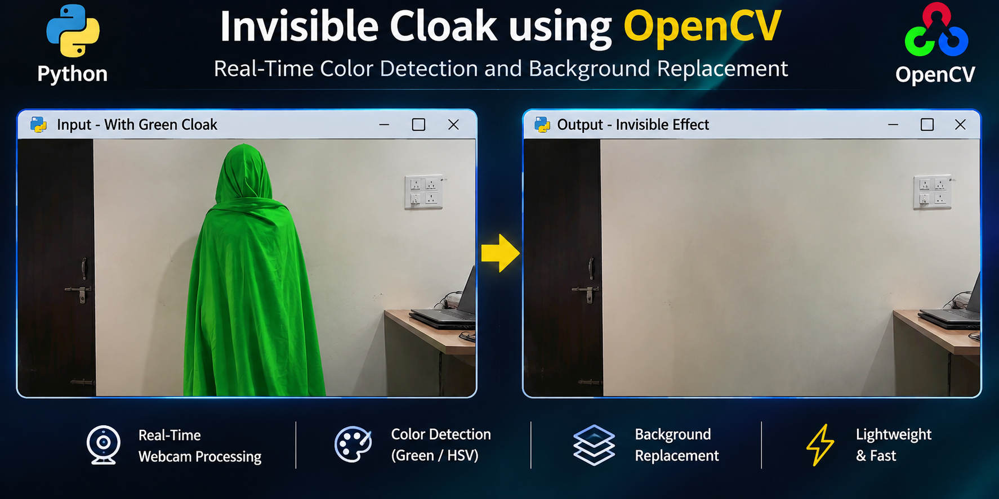

invisible-cloak-opencv-code.zip
Zip Archive
Pasted markdown(7).md
File

how can i run this project
if his head is not covered with green clothe then how it disappears

You're absolutely right! That's a technical mistake in the generated image.

In your actual OpenCV project, only the pixels detected as green are replaced with the captured background.

Therefore:

Green cloth covering the body → Body disappears.
Head without green cloth → Head remains visible.
Hands without green cloth → Hands remain visible.
Any uncovered skin or clothing → Remains visible.
What would make the demonstration realistic?

The person should wear a full-body green cloak with a green hood covering the head, so the entire person disappears.

For your GitHub portfolio, I recommend showing:

Input: Person completely covered in green cloth, including the head.
Output: The same background with the entire person disappeared.
Identical camera angle, lighting, furniture and background in both frames.

One more important point: Use an actual screenshot of your running project for your GitHub README rather than an AI-generated image. It demonstrates that your implementation genuinely works and is much more credible to interviewers.

re-generate image
now, give me a professional readme.md content for this project including this output , which is saved in screenshots folder with the name of output.png

I've created a professional, GitHub-ready README.md for your Invisible Cloak using OpenCV project.

📄 Download README.md

Download Professional README.md

Included sections
Project Overview
Output Preview
Key Features
Technologies Used
Project Folder Structure
System Requirements
Installation and Setup
Running Instructions
How the Invisible Cloak Works
Troubleshooting
Limitations
Learning Outcomes
Author & Acknowledgement
Screenshot integration

I've included your specified image path:

Your repository should look like this:

Invisible-Cloak-OpenCV/
│
├── Invisible_Cloak.py
├── README.md
├── requirements.txt
├── .gitignore
│
├── docs/
│   └── Invisible_Cloak_Project_Run_Guide.docx
│
└── screenshots/
    └── output.png
Final recommendation

Before publishing, replace the illustrative AI-generated output image with a genuine screenshot from your running application if possible. This will make your GitHub portfolio more credible during technical interviews. 

README.md
Document

README.md
Invisible Cloak Using OpenCV

A real-time computer vision project that creates an invisible cloak
effect using Python, OpenCV, and a webcam. The application detects a
selected green colour in the live camera feed and replaces the detected
region with a previously captured background frame.

Project category: Computer Vision · Image Processing
Language: Python 3
Libraries: OpenCV, NumPy
Execution environment: Windows

Output Preview

The image below illustrates the intended effect: a person fully covered
by green fabric is replaced by the previously captured background.

Output preview image: screenshots/output.png.

Note: The preview is an illustrative project image. For a
portfolio demonstration, consider replacing it with a genuine
screenshot captured from your own running application.

Project Overview

The Invisible Cloak project demonstrates colour-based image segmentation
and background replacement. When the program starts, it captures an
image of the empty scene from the webcam. It then processes live video
frames, identifies pixels within a configured green HSV range, and
replaces those pixels with the corresponding pixels from the saved
background.

The result creates the visual illusion that the green-covered person or
object has disappeared.

This is a traditional computer-vision/image-processing project, not a
trained AI or machine-learning model.

Key Features
Real-time webcam video capture.
Green-colour detection in HSV colour space.
Binary mask generation using OpenCV.
Background replacement using bitwise image operations.
Mask refinement using morphological operations.
Live display of the processed output.
Technologies Used

Technology Purpose

Python 3 Application programming language
OpenCV (opencv-python) Webcam access and image processing
NumPy Array operations and image-processing kernels

Project Structure
Invisible-Cloak-OpenCV/
│
├── Invisible_Cloak.py
├── README.md
├── requirements.txt
├── .gitignore
│
├── docs/
│   └── Invisible_Cloak_Project_Run_Guide.docx
│
└── screenshots/
    └── output.png
Requirements

Before running the project, make sure you have:

Windows 10 or Windows 11.
Python 3 installed.
The Windows Python Launcher (py) available in the terminal.
A working built-in or external webcam.
A plain green cloth.
A well-lit environment.
Git installed if you want to clone the repository.
Windows Python command: py

The commands in this guide use py rather than python. On some
Windows systems, the python command may not be recognised even when
Python is installed, while the Python Launcher command py is
available.

Verify the launcher:

py --version

If py is not recognised, install Python for Windows from
python.org, make sure the Python
Launcher is selected during installation, and reopen the terminal.
Verify again with py --version.

Installation and Setup
1. Clone the repository
git clone https://github.com/SUMEETKUMARMONTI/Invisible-Cloak-OpenCV.git
cd Invisible-Cloak-OpenCV

Alternatively, download the repository as a ZIP file from GitHub and
extract it.

2. Create a virtual environment
py -m venv venv
3. Activate the virtual environment

PowerShell:

.\venv\Scripts\Activate.ps1

If PowerShell prevents script activation, allow it for the current
terminal session and activate again:

Set-ExecutionPolicy -Scope Process -ExecutionPolicy Bypass
.\venv\Scripts\Activate.ps1

Command Prompt (cmd.exe):

venv\Scripts\activate.bat

When activation succeeds, (venv) should appear at the beginning of the
terminal prompt.

4. Install dependencies
py -m pip install --upgrade pip
py -m pip install -r requirements.txt

If requirements.txt is not present, install the packages directly:

py -m pip install opencv-python numpy
5. Run the application

From the project root directory, with the virtual environment activated,
run:

py Invisible_Cloak.py

The webcam should start and the processed video should appear in the
application window. Press q while the output window is active to
exit.

How to Use the Invisible Cloak
Place the webcam or laptop on a stable surface.
Keep the camera fixed throughout the demonstration.
Choose a plain green cloth that contrasts with the background.
Start the application.
Move completely out of the camera's view while the program captures
the background.
Once background capture is complete, enter the frame wearing or
holding the green cloth.
The detected green region should be replaced by the saved
background.
Press q to close the application.
Tips for Better Results
Use a bright, evenly lit room.
Avoid green objects in the background.
Keep the camera and background stationary.
Avoid shadows and folds where possible.
Cover the complete area you want the program to replace. Any
uncovered body parts will remain visible.
How It Works

The project follows a colour-segmentation and compositing workflow:

Webcam initialisation: OpenCV opens the camera using
cv2.VideoCapture(0).
Background capture: The program captures a background frame
before starting continuous processing.
HSV conversion: Each live frame is converted from BGR to HSV
colour space.
Green-colour segmentation: cv2.inRange() creates a binary mask
using the configured HSV thresholds.
Mask refinement: Morphological closing, opening, and dilation
help reduce noise and small gaps.
Background extraction: Bitwise operations select the saved
background in the detected green region.
Frame composition: The selected background and the remaining
live-frame region are combined to produce the output.
Troubleshooting

Issue Suggested solution

py is not recognised Install or repair Python for Windows
with the Python Launcher, reopen the
terminal, and retry py --version.

No module named cv2 Activate the virtual environment and
run
py -m pip install opencv-python.

No module named numpy Activate the virtual environment and
run py -m pip install numpy.

Webcam does not open Close other applications using the
camera and check Windows camera
privacy permissions.

Output is black or frozen Check the webcam connection and
confirm that another application is
not using it.

Green cloth is not detected Improve lighting, use a distinct
green cloth, and adjust the HSV
thresholds if necessary.

Green edges or noisy output Experiment with the morphological
kernel sizes in the Python script.

Limitations
The camera must remain stationary after the background is captured.
The effect depends on the green cloth being distinguishable from the
background.
Lighting, shadows, camera quality, and cloth colour can affect
detection.
Other green objects in the frame may also be detected and replaced.
Fixed HSV thresholds may need adjustment for different environments.
The effect only replaces pixels identified by the colour mask;
uncovered areas remain visible.
Learning Outcomes

This project provides practical exposure to:

Webcam capture and frame processing.
BGR and HSV colour spaces.
Colour thresholding and image segmentation.
Binary masks and bitwise operations.
Morphological image processing.
Real-time computer vision workflows.
Acknowledgement

This project is based on the colour-detection and segmentation approach
described in the DataFlair tutorial: Harry Potter's Invisible Cloak
using OpenCV -- Python
Project.
The tutorial is acknowledged as the source of inspiration/reference for
this learning project.

Author

Sumeet Kumar Monti

GitHub: @SUMEETKUMARMONTI

If you explore or improve this project, you can experiment with
different HSV colour ranges, refine the mask processing, and enhance
webcam error handling.